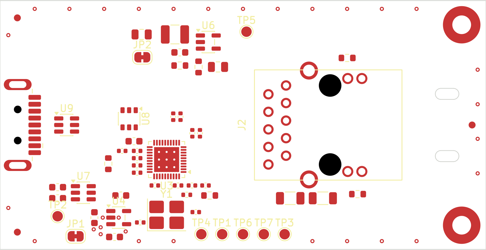

# raccoon-tap — placement baseline (task 8, 2026-11-02)

The board after `tools/gen_pcb.py` was last run on it: U3 turned, every part
from tasks 5 to 7 placed, mounting and strain relief added, the power plane
split. Task 9 routes this board and freezes the geometry; nothing here is
routed. Later review runs compare against this directory, not against
`../2026-10-31-baseline/`, which describes a board that no longer exists (it had
33 footprints, U3 at 0 degrees and none of tasks 5 to 7).

Measured design state (SHA-256 of the analysed files):

| File | SHA-256 |
|---|---|
| `hardware/kicad/raccoon-tap.kicad_sch` | `eebaf3eb44ff574347a29752f2b9e553a1b2223f95145ed4103180eeb6530297` |
| `hardware/kicad/raccoon-tap.kicad_pcb` | `d977444bb2914eeb3c73670061916a0dec68ca725b110aa732104a777523d7ad` |



Bottom side: `placement-bottom.png` (C21 is the only part on it).

## Measured state

| Metric | Baseline (2026-10-31) | Now | Source |
|---|---|---|---|
| Footprints | 33 | 58 (all placed, none parked) | `pcb.json` |
| Board | 58 x 36 mm | 70 x 36 mm | see "Board size" |
| DRC errors | 0 | **0** | `drc.rpt` |
| DRC warnings | 43 | 47 (40 `via_dangling`, 5 `silk_over_copper`, 2 `silk_overlap`) | `drc.rpt` |
| Unconnected items | 134 | 170 | `drc.rpt`, errors by KiCad's own severity, counted separately; nothing is routed |
| DRC errors, zones refilled | not measured | **0** (adds 11 `isolated_copper` warnings: the In2 islands have no vias yet) | `kicad-cli pcb drc --refill-zones` |
| ERC | 0 errors, 0 warnings | 0 errors, 0 warnings | `erc.rpt` |
| `check_kicad.py` | 23 failures on the stale PCB | passes | |
| U3 decoupling distance (cap to nearest U3 pad centre) | 3.56 to 7.63 mm | 1.33 to 3.57 mm | `pcb.json` `decoupling_proximity` |
| Buck switching loop (U6, L2, C3) | 7.9 mm2 | 7.9 mm2 | `pcb.json` |
| EMC score | 76.0 | 59.5, see below | `emc.json` |
| Hottest part | U4, 69.8 C | U4, 67.5 C | `thermal.json` |
| Zones | 3 | 17: 9 copper (In1 and bottom GND, six In2 islands, the U4 patch) and 8 keepout rule areas (four per mounting hole) | `pcb.json` |

DRC progression while working (every change was measured, per the
`OPEN_QUESTIONS.md` 263-to-269 lesson):

| Run | Errors | Warnings | What it was |
|---|---|---|---|
| HEAD board, before any change | 0 | 43 | the stale board, 33 footprints |
| first full placement | 3 | 53 | two mounting holes inside their own keepout (the hole's courtyard is 2.99 mm, the ring began at 2.96) and C21's pad 0.025 mm from J2 pin 5 |
| ring radius and C21 corrected | 0 | 55 | |
| JP1, C5, via search, fiducials, keepout in sectors, reference text moved | **0** | **47** | this directory |

EMC score: it fell because the new parts are unrouted and unprotected as the
analyzer sees them, not because placement got worse. Three errors: `DC-001`
(it reads U9, the USB 2.0 ESD array, as a 5 V IC wanting a decoupling cap; the
known false positive of ruling Z), `ES-002` (no GND via by U9; there are no vias
yet), `IO-001` (no filter at J2; the jack's magnetics are the filter, as in the
baseline). The 22 `DC-003` warnings are "capacitor far from via" on a board
without vias; `ES-001` ("U9 far from J3") measures from J3's origin, which is
15 mm off the board, not from its pads (3.6 mm away).

## What was done

### U3 turned to 180 degrees, and what that does for the MDI runs

At 0 degrees the MDI pins 1 to 10 were on U3's left edge, facing the USB plug.
At 180 they are on the right edge and face J2 across an open corridor
(U3 pad edge x = 26.9 mm, first J2 pin x = 38.7 mm). The SuperSpeed and USB 2.0
pins 12 to 19 are on the top edge, the supply pins on the left edge, the crystal
pins 35/36 on the bottom edge. Y1, C19, C20, R14 and the decoupling ring went
with it. The MDI pairs no longer wrap round the package or cross the
SuperSpeed fan-out.

**What rotation alone does not do, and what I found about it.** U3's pins and
J2's pins both run counter-clockwise round their package. Two such parts that
face each other present the pairs in opposite order: U3's east edge reads
MDI3, MDI2, MDI1, MDI0 from north to south, J2's pin row reads MDI0 to MDI3.
This is a property of the two parts, not of a rotation: I tried all four
rotations of U3 against all four of J2 on each of the four sides of U3 (a
throwaway sweep, not committed), and every combination in which the two face
each other reverses the order. Straight ratsnest lines from U3's eight MDI
signal pads to the J2 pins of the same number, which `scratch_route_check.py`
counts and prints:

```
as placed:               27 of 28 pin-to-pin crossings, 6 of 6 pair-to-pair
J2 on the bottom side:    0 of 28,                      0 of 6
```

A single layer cannot do it: the cyclic order of four strands between two
parts has to be reversed, and a planar bus cannot reverse it.

I did not change it, because every remedy is a decision that is not mine:

1. **As built: J2 on top, cross the pairs through the bottom layer.** Three
   stages, each one pair dipping under the others through two vias per trace:
   MDI0 under MDI1 to 3, then MDI1 under MDI2 and 3, then MDI2 under MDI3.
   12 vias in 100 ohm pairs, about 2.5 to 3 mm of corridor per stage. The
   corridor is clear on both signal layers and In2 under it is one island
   (+3V3) so the bottom-layer legs have a plane to look at. It is about 8.3 mm
   long (x 29.5 to 37.8 mm) because C7 and C13 occupy the first 2.5 mm beside
   U3's north-east corner. **I did not route this; that it fits is an
   estimate, not a result.**
2. **J2 on the bottom side, mirrored.** Planar on F.Cu, 0 crossings. The jack
   then hangs 13.45 mm below the board. For a board that is cantilevered from
   the lower USB port of a Pi lying on a desk that is a mechanical question
   for the person who owns 11.10 (it may tilt the Pi), and the part is
   described as "tab-up" in the netlist. Not done.
3. **A tab-down variant of the jack**, if LINK-PP makes one: the footprint is
   mirrored, so it solves the order with J2 on top. A BOM change, not done.

### Board size

70 x 36 mm, from 58 x 36. The extra 12 mm is a tail beyond J2's front face
(x 58.2 mm): the cable boot lies on it, and a tie through two slots holds it.
The tail was the only way to give the cable something to be tied to; the
alternative was no strain relief that touches the cable. Nothing in the layout
needed the board to grow for room.

### Mounting and strain relief

* **H1 and H2**, two M2.5 holes, 2.7 mm drill, plated, 5.4 mm pad tied to GND,
  at (66.5, 3.5) and (66.5, 32.5): the two corners furthest from the USB plug,
  3.5 mm in from both edges, the Pi 4's own edge distance. The plated pad ties
  to the In1 and bottom GND planes; a keepout ring (r 3.02 to 3.9 mm; no
  tracks, vias or parts, pour allowed) keeps the screw head's neighbourhood
  clear. They are `bom: false` components in `netlist.yaml` (H1, H2) so that
  `check_kicad.py`'s "exactly the netlist's components" still holds.
* **Two slots**, 3.4 x 1.6 mm on Edge.Cuts, at (64.4, 13.5) and (64.4, 22.5),
  9 mm apart, 6.2 mm beyond J2's front face: a cable tie goes down one, under
  the board and up the other, round the cable boot. The cable pull then goes
  into the board and from there into the two screws, not into the USB port.
* **Alignment with the Pi 4: not achievable as written, and I did not pretend.**
  The Pi's mounting holes are 58 x 49 mm apart and all lie inside its own
  85 x 56 mm outline. This board is cantilevered past the Pi's USB edge, so
  none of its holes can coincide with the Pi's. What I could align is the
  convention: M2.5 with the Pi's 3.5 mm edge distance. A hole pitch of 49 mm
  along the board (matching the Pi's short axis) would need a 56 mm tall board;
  I did not grow it for that. The board is meant to be fixed to whatever the Pi
  is fixed to.
* **Lower port, tab down:** nothing on the PCB changes. J3 is on the top side and
  its position (shell overhanging the left edge) is as before.

### U8, C22 and C23 against the task 7 geometry

`scratch_route_check.py` (this directory) lays the SuperSpeed lanes and the MDI
escapes on a copy of the board and runs KiCad's DRC with the project's rules.
Result: 0 violations other than the structural item below. What it took:

* **A new footprint for U8**, `raccoon:SOT-23-6_SP3019_LittelfuseLand`. KiCad's
  SOT-23-6 has 1.325 mm pads and leaves a 0.95 mm channel between the pad rows.
  Two lines of different pairs do not fit through it at the clearances in
  force: 0.3 mm to the GND pad (the Power class), 0.2 mm between the two
  lines, 0.2 mm to the pads on the other side, which adds up to about 1.0 mm
  with 0.15 mm lines. The Littelfuse datasheet
  committed in `hardware/datasheets/` gives its own land pattern on page 5
  ("Recommended soldering pad layout"): pads 0.60 x 0.85 mm, 0.95 mm pitch,
  3.33 mm overall. That leaves a 1.63 mm channel. The footprint uses exactly
  that. Pin numbering is unchanged (pin 1 is the dotted corner).
* **U8 turned to 270 degrees**, TX row (pins 1 to 3) north, RX row (4 to 6)
  south. From north to south the four lines are TX_N above the TX row,
  TX_P and RX_N through the channel, RX_P below the RX row: the same order as J3's
  pads, so no crossing. Each line reaches its pad with a stub of 0.3 to 0.6 mm;
  the pairs are coupled (0.375 mm pitch) from J3 to about 1.5 mm before U8,
  open to 1.5 to 2 mm across it and close again 1.5 mm after it: roughly 7 mm of
  each pair is open. This is a tee with short stubs, not "in and out of the
  same pad" as `netlist.yaml` `design_notes.esd_protection` suggests; I did not
  find a way to do the latter with two pairs on one four-line array.
* **C22 and C23 vertical, at 1.05 mm pitch, not the 0.82 mm of the note.**
  The note's figure is the pad-to-pad clearance; KiCad's courtyard rule
  (`courtyards_overlap`, an error) needs 1.0 mm between two vertical 0402s. The
  pair opens from 0.4 to 1.05 mm in the 0.6 mm after the neck and closes
  again above the capacitors. They sit 3.3 mm from U3's TX pads, so they do
  not lengthen the neck: a neck of 0.6 mm from the pad centre clears every
  clearance the 0.2 mm class asks for (the note allows 1.0 mm; use the
  shortest). The run is the same at 1.0 mm.

### The structural item the scratch run reports (for the controller)

U3's pads are on a 0.40 mm pitch. A track leaving a pad passes 0.20 mm from the
next pad, and the **Power** net class asks for **0.30 mm** to any supply or GND
item. Where the neighbour is a supply pad (U3 pins 11 and 14 on the USB side,
3 and 8 on the MDI side; the run has them) the escape violates it, whatever the
neck: 0.15 mm gives 0.200 mm, 0.10 mm would give 0.225 mm. A supply pad's own
escape, between two signal pads, meets the same 0.3 mm (not run, same
geometry). The existing U3 rule in `raccoon-tap.kicad_dru` relaxes pad-to-pad
spacing only. Ruling AG ("no clearance exception") was about the 0.175 against
0.2 mm of the signal class; this one is different and needs a decision before
task 9: either `Power` clearance 0.2 mm (5 V does not need 0.3), or a
`.kicad_dru` rule for tracks within 1 mm of a U3 pad. I changed neither. The
scratch run lists them: 14 items at the 0.6 mm neck, 7 at the 1.0 mm neck
(`scratch_route_check.py 1.0`).

### USB 2.0 pair: what U9 does and does not do

I assumed U9's pass-through was diagonal (pins 1 and 6 on opposite corners).
It is not: pins 1 and 6 are the two ends of one row, so D+ goes straight
through and the pair keeps its order. Consequences for task 9, none of which I
could resolve by placement:

* At J3 the pads are TX, D+ D-, RX from top to bottom. At U3's top edge the
  pins are D+ D-, RX, TX from west to east. D+/D- therefore has to cross the RX
  pair: it takes the bottom layer, four vias.
* Taking the pair west from U3, D- ends up above D+. At J3 D+ is above D-. The
  order has to be reversed once more on the way, which costs two more vias on
  D+. Total about six vias on a 480 Mbit/s pair, not routed or checked.
* The scratch run shows two vias fit at (12.2, 17.05) and (12.2, 18.95), beside
  the RX pair's rise and clear of U9's pads. U9 pin 5 (VBUS) has room for a via
  at (11.9, 18.0); pin 2 (GND) is on J3's GND pad 7's row (y = 18) and can take
  a trace to that pad instead of a via. None of this is routed.

## Other placement work

* **Decoupling:** west column of 0402s at x = 19.75 mm (pad 1 towards U3), C8
  (0603) above it on pin 20, C7 and C13 at the north-east corner, C15, C14, C9
  and C12 along the bottom either side of the crystal channel. C16 (pins 14
  and 19, which have no free side) is in a second column, 3.5 mm out. C12 and
  C13 (AVDD10 pins 3 and 8) cannot be nearer: those pads sit between MDI pairs.
* **C21** on the bottom side, 1.5 mm from J2 pin 5: the centre-tap pins are in
  the middle of the pin field, between the pairs, and the pins are through-hole.
* **J2** turned so the jack's opening faces the board edge (rotation 90):
  signal pins at x 38.7 and 41.2 mm, LEDs at the front.
* **Buck:** U6 moved to the top middle, above U3. C3 sits 2.7 mm under the IN
  pin. R5/R6 are 4 to 5 mm south of LX and L2, the FB trace runs away from
  the switch node.
* **U4:** GND copper patch on F.Cu, 8.2 x 5.7 mm, joined to pin 2 without
  thermal relief, six vias to In1 and the bottom pour.
* **In2:** six islands. +5V (J3 and U7 corner), +5V_SW twice (a strip on the left,
  and the buck's input), +1V0 (above U3), +3V3 (below and east of U3, the
  corridor). It is a pre-partition: the pins of U3 that want +1V0 and +3V3
  alternate round the package, so some connections will be surface tracks.
* **U3's thermal vias:** 3 x 3, tented from the back.
* **Y1:** `Crystal_SMD_3225-4Pin_3.2x2.5mm_HandSoldering`, pads 2.1 x 1.8 mm,
  0.9 mm beyond the body (ruling AC). `netlist.yaml` follows.
* **DNP:** R12 and C24 carry `dnp`, `exclude_from_pos_files` and
  `exclude_from_bom` on their footprints; test pads, jumpers, mounting holes
  and fiducials carry the two exclusions. `kicad-cli pcb export pos --smd-only`
  lists 41 parts, none of them R12 or C24, and lists U3, Y1 and C21 (bottom). A new
  check in `check_kicad.py` (`check_pcb_fitting`) keeps it so, with three
  mutation tests.
* **Three fiducials** (FID1 to FID3): kicad-happy `FD-001` and PCBWay's
  pick-and-place for U3 and Y1.
* **Reference text:** passives, holes and fiducials keep it on F.Fab only.

## Files

| File | |
|---|---|
| `drc.rpt` | `kicad-cli pcb drc --severity-all` |
| `erc.rpt` | `kicad-cli sch erc --severity-all` |
| `schematic.json`, `pcb.json`, `cross.json`, `emc.json`, `thermal.json`, `capability_mode.json` | kicad-happy, same commands as the baseline README |
| `scratch_route_check.py` | the SuperSpeed and MDI fit run described above |
| `placement-top.png`, `placement-bottom.png` | the board |

Reproducing, from the repository root:

```sh
KIPY=/Applications/KiCad/KiCad.app/Contents/Frameworks/Python.framework/Versions/3.9/bin/python3
KH=/opt/homebrew/bin/python3.12
R=hardware/review/2026-10-31-placement
S=vendor/kicad-happy/skills
$KIPY hardware/tools/gen_pcb.py
kicad-cli pcb drc --severity-all --output $R/drc.rpt hardware/kicad/raccoon-tap.kicad_pcb
kicad-cli sch erc --severity-all --output $R/erc.rpt hardware/kicad/raccoon-tap.kicad_sch
$KH $S/kicad/scripts/analyze_schematic.py hardware/kicad/raccoon-tap.kicad_sch --output $R/schematic.json
$KH $S/kicad/scripts/analyze_pcb.py hardware/kicad/raccoon-tap.kicad_pcb --full --schematic $R/schematic.json --stage layout --output $R/pcb.json
$KH $S/kicad/scripts/cross_analysis.py -s $R/schematic.json -p $R/pcb.json --output $R/cross.json
$KH $S/emc/scripts/analyze_emc.py -s $R/schematic.json -p $R/pcb.json --output $R/emc.json
$KH $S/kicad/scripts/analyze_thermal.py -s $R/schematic.json -p $R/pcb.json --output $R/thermal.json
$KIPY $R/scratch_route_check.py
python3 hardware/tests/check_kicad.py -v
```

`gen_pcb.py` assigns fresh UUIDs and visits the footprints in a different
order on every run, so regenerating produces a different file (same geometry,
same nets). This directory's reports were taken from the committed board.

## For task 9

* The MDI order reversal above is the first thing to settle.
* The `Power` clearance against U3's pads is the second.
* Reserved, do not put anything in them: the MDI corridor (x 27 to 38.6, y 10
  to 28, both layers), the USB lane band west of U3 (x 6.5 to 26.2, y 13.4 to
  19.6 and the lanes down to the RX pads at y 20 and 22), the crystal channel
  (x 23.3 to 24.7, y 25.7 to 29.6).
* Test points TP6 and TP7 are 12 mm from the pins they probe (the bottom edge
  is the only place they fit); the nets are low speed, a long thin trace on
  the bottom layer is fine.
